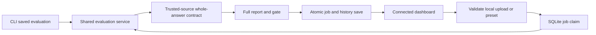

# Connected evaluation, local setup and trust boundaries

Project 03, 2026-10-23. See [baseline](portfolio-baseline.md), [verification](portfolio-verification.md), [case study](portfolio-case-study.md), and [walkthrough](portfolio-walkthrough.md). The CLI remains the primary engineering interface. The dashboard calls the same saved-response evaluation service.

## Two experiences

The **sample** experience is an immediate, six-case interactive story. It does not execute an evaluation, call a provider or contact the API. The persistent label and scenario controls explain that its data is synthetic. Reset restores the entire story; reload resets sample scenarios.

The **connected** experience imports validated local files, explicitly launches a real evaluation, writes a full report to SQLite and inspects the saved results. Bundled responses are still synthetic, with agent-authored labels. Actual execution proves the mechanism; it does not establish human agreement or real-model quality. API failure stays an error until Retry or an explicit switch to sample mode.

## Reproduce locally

From the clone root, using Python 3.11 or newer:

```powershell
python -m venv .venv
.venv\Scripts\python.exe -m pip install -e ".[dev,server,llm]"
.venv\Scripts\python.exe -m evalforge.cli eval example_suites/portfolio_evidence.yaml --backend saved --response-file data/portfolio/candidate.jsonl --strict-evidence --db .tmp/review/history.db --evidence-dir artifacts/candidate
```

Create `.tmp/review` first. The candidate returns1 intentionally; baseline and repaired return0, indeterminate returns2. `scripts/check_strict_evidence.py` asserts these outcomes through the public CLI. No provider credentials are required.

In an API terminal:

```powershell
$env:EVALFORGE_ALLOWED_ORIGINS='http://localhost:3303'
$env:EVALFORGE_UPLOAD_DIR=(Join-Path (Get-Location) '.tmp/review/uploads')
.venv\Scripts\python.exe -m evalforge.cli serve --host 127.0.0.1 --port 8200 --db .tmp/review/history.db
```

In a separate terminal, from `frontend/`:

```powershell
npm ci
$env:NEXT_PUBLIC_API_URL='http://127.0.0.1:8200'
$env:NEXT_PUBLIC_DEMO_MODE='false'
npm run build:connected
npm run start:connected -- --port 3303
```

Open `http://localhost:3303`, select connected mode, then Evaluate. Choose a bundled profile or upload a YAML suite plus saved-response JSONL. **Validate upload** imports without running. **Run evaluation** is the separate execution action. The final job status and release gate are separate: completed can mean a failed or indeterminate gate. Inspect the resulting run; compare it with a baseline from the same dataset revision and suite contract.

Default `npm run build` preserves the static preview; the connected build supports new numeric run URLs at runtime. Keep production builds and browser tests sequential: both use generated Next.js configuration/types. The live suite owns disposable databases and API processes and refuses an occupied API port. Do not point it at a personal database.

## Data and judge contract

Each JSONL record has schema_version1, exact case_id, answer, retrieved_sources (`id`, `version`, `content`), citations (`claim`, `source_id`, `source_version`, `quote`) and provenance. Runner context carries exact case identity; prompt similarity is never a lookup key. Duplicate, absent and extra IDs fail validation before execution.

The suite owns authoritative source snapshots and the answer contract. A response cannot make its own source content authoritative. The strict judge checks exact source/version/content and approved claim-to-passage links, then the entire answer against explicitly enumerated accepted answers. An exhaustive contract may reject other answers. Without a bounded deterministic contract, free-form entailment remains indeterminate. Passing an arbitrary quotation or mentioning the expected source never proves support.

Outcomes are mutually exclusive: passed, failed, indeterminate, error. Legacy summary fields remain; strict gate counts reconcile to total. Exit0 means all declared contracts passed;1 means a complete assessment with definite failures;2 means invalid input, execution/judge error, required indeterminate evidence, unknown origin or simulated quality scoring. Synthetic fixture contracts can pass, but `quality_validated` remains false.

The 100-case corpus has60 answerable,20 unanswerable,10 conflicting/stale,10 adversarial. Development20 is12/4/2/2; held-out80 is48/16/8/8. Source families do not cross splits. The manifest pins source and response hashes, authorship and CC0 ownership. This is agreement with authored expectations, not independent human calibration. Replacing the responses with real application records requires honest provenance and independently reviewed expectations before making quality claims.

## Local API

| Route | Behavior |
| --- | --- |
| GET `/api/evaluation-profiles` | Bundled and uploaded descriptors, counts/revision/hashes, no host paths |
| POST `/api/evaluation-profiles` | Multipart `suite` and `responses`; validate/import only |
| POST `/api/evaluations` | Explicit profile_id plus UUID request_id; launch or return original job |
| GET `/api/evaluations/{id}` | Actual status/progress, gate, saved run or error |
| GET `/api/runs`, GET `/api/runs/{id}` | Existing history fields plus normalized cases and truthful provenance |
| POST `/api/runs/compare` | Existing deltas plus aligned cases, added/removed and comparability |

Uploads allow at most2MiB YAML,10MiB JSONL,500cases. UTF-8, safe YAML, no includes, external file references, providers or executable plugins. The web path only uses saved responses; it never executes uploaded commands or chooses arbitrary host paths. Server-generated IDs identify stored inputs, and original hashes are rechecked before launch.

One SQLite claim allows one queued/running job. Repeated request IDs for the same profile return the original job; conflicting reuse and a competing launch return409. Report persistence and job completion share one transaction. Restart marks queued/running jobs interrupted; nothing is automatically relaunched. An explicit new request is required. This is a local single-process application, not a distributed queue.

Profiles and inputs are retained locally until manual cleanup. Stop the API, back up the database if desired, then remove only the dedicated disposable database/upload directory you created. Deleting only uploaded files makes their profiles unavailable; it does not erase historical reports. Reports preserve evaluated answers and source text, so use public-safe or synthetic inputs. There is no automatic retention or confidential-data redaction guarantee for uploaded content.

Bind to 127.0.0.1, configure explicit frontend origins and keep the API local. Origin checks are a local browser boundary, not authentication. No hosted multi-user access, arbitrary crash/power-loss durability, provider validation or production security certification is claimed.

## Architecture



The preview uses a separate explicit sample source. It cannot silently replace failed connected execution. Historical rows without method/revision/evidence remain unknown. A comparison with unknown or different dataset/suite metadata exposes the mismatch instead of declaring a regression.
